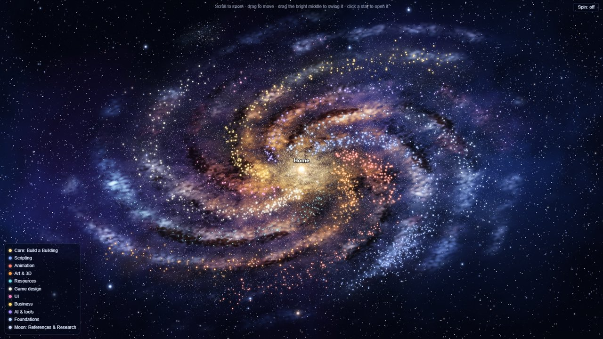

# Spiral Galaxy

See your Obsidian vault as a slowly spinning spiral galaxy.

## ⬇️ [Download Spiral Galaxy](https://github.com/Duck5562/spiral-galaxy/releases/latest/download/spiral-galaxy.zip)

## New in 2.0

- **A real space look:** a deep-space sky full of stars behind a galaxy coloured like photos of the Milky Way, with a gold and orange core fading to blue at the edges, glowing gas clouds and dark dust lanes.
- **Made of dots:** the galaxy's clouds, dust and about 100,000 tiny stars are separate dots. Swing it and they trail and scatter on their own; zoom in and they stay sharp.
- **Flatter and tilted**, like a galaxy seen at an angle, and it spins the other way so the arms trail behind.
- **Your notes stand out:** crisp stars that aren't all the same brightness, and a bigger centre note.

## How to put it in your Obsidian

1. **Download** the zip with the link above, then **unzip** it (right-click → Extract All). You get a folder called `spiral-galaxy`.
2. **Find your vault's plugins folder.**
   - Open your vault folder (the folder with your notes in it).
   - Go into the `.obsidian` folder, then `plugins`. If there's no `plugins` folder, make one.
   - Can't see `.obsidian`? It's hidden.
     - Windows: in File Explorer, **View → Show → Hidden items**.
     - Mac: press **Cmd + Shift + .** in Finder.
   - Shortcut: in Obsidian, go to **Settings → Community plugins** and press the 📁 folder icon. It opens the plugins folder for you.
3. **Move the `spiral-galaxy` folder into `plugins`.** You should end up with `.obsidian/plugins/spiral-galaxy/main.js`.
   - Updating from 1.0? Replace the old files with the new ones. Your settings are kept.
4. **Turn it on in Obsidian.**
   - Go to **Settings → Community plugins**.
   - If it says Restricted mode is on, press **Turn on community plugins**.
   - Press the 🔄 refresh button next to "Installed plugins", then switch on **Spiral Galaxy**.
5. **Open it:** click the ✨ **sparkles** button on the left edge of Obsidian.

That's it!

## What it does

- **Every note is a star.** Notes with more links are bigger stars. Some shine brighter than others.
- **Every arm is a group of folders**, each in its own colour. Every folder is a glowing star cluster along its arm, with its hub note (Start Here, README, Index, Hub, MOC, Overview, or its most-linked note) in the middle.
- **Your top-level notes are the bright core.** The centre note (e.g. `Home.md`) sits in the very middle as the biggest star.
- **"Moon" folders** (references, archives, …) become a little satellite galaxy.

| Do | What happens |
|---|---|
| Hover a star | Its name, its link count and lines to everything it links with. Faint stars light up |
| Click a star | Opens the note in a new tab |
| Scroll | Zoom (folder names fade in when you zoom in) |
| Drag empty space | Move around |
| Drag the bright middle | The galaxy follows like jelly: its dots trail behind and wobble back into place |
| **Spin** button | Turn the slow spin on or off |

## Settings

Find them in **Settings → Spiral Galaxy**.

- **Arms:** by default the arms are picked automatically from your folders. Every top-level folder becomes a star cluster; if one folder holds most of your vault, its subfolders are used instead. Press **Fill in from my folders** to edit them: name, colour and folders for each arm. Arms can be added, removed and moved.
- **Core:** which folders' loose notes form the bright core ("/" is the vault root), its name and colours, and the centre note.
- **Moon:** folders that become the satellite galaxy, and its name and colour.
- **Look and feel:** spin when opened, spin speed, space dust (none / light / normal / rich: the dust lanes and tiny stars), jelly drag, and the legend.

Star positions are seeded from each note's path, so your galaxy looks the same every time, and new notes simply join their folder's cluster.

Colours: 2.0 has new default colours. If you filled in your own arms in 1.0, your colours are kept; pick new ones in the settings if you'd like the new look.

## Performance

The galaxy's dots are drawn by your graphics card (WebGL2), and the deep-space sky is painted once. When you open the galaxy, the dots are worked out in short bursts so Obsidian stays smooth, and the galaxy fades in after a second. The view only redraws while something moves. If your computer doesn't have WebGL2, you get a simpler galaxy instead.

## Privacy

Everything happens inside Obsidian. The plugin makes no network requests and only reads your notes' paths and links.

## Licence

MIT
